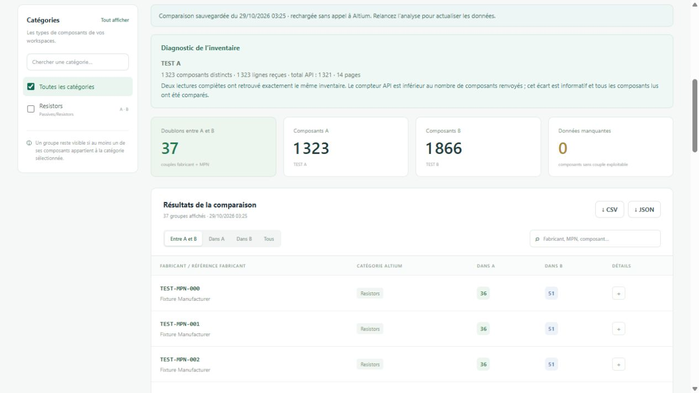

# Component Lens

A portable, read-only Windows app for finding duplicate components across two Altium 365 workspaces. Compare **Manufacturer + Manufacturer Part Number**, filter by actual Altium component categories, and use the interface in **English, French or Spanish**.

[Français](docs/README.fr.md) · [Español](docs/README.es.md)



## Run without installing anything

Download `ComponentLens-1.1.0-win-x64.zip` from this repository's Releases, extract it, then double-click **ComponentLens.exe**. The executable includes its .NET runtime and opens your default browser. Keep its console window open while using the app. Choose **Quit** or close the console to stop it.

Requires Windows 10/11 x64, a modern browser, network access to Altium 365, and an API access token with library/component read access for each workspace. No Altium Designer, Node.js or .NET installation is needed. The embedded runtime may unpack native files into the user's temporary directory on first launch. The release is unsigned.

1. Enter the URL and API access token for workspace A. Select **Connect**.
2. Repeat for workspace B. A pasted `Bearer …` prefix is accepted.
3. Select **Find duplicates**. The app reads all pages and each component's parameters.
4. Filter by category, search by manufacturer/MPN/component, and expand a result to inspect every occurrence and its evidence.
5. Export the filtered groups to CSV or JSON. Select the missing-data card to review and export data issues.

All matching groups appear on one page, with no Next/Previous buttons. Connections and the latest completed comparison are saved automatically. Subsequent launches restore them, including the original comparison date, without contacting Altium. Select **Find duplicates** when you want fresh data. Upgrading from 1.0.x requires entering the two tokens once because those releases did not save them.

**Explore demo** works without Altium tokens and uses clearly marked fictitious data. It does not contact Altium.

## What counts as a duplicate

- A match requires the **same manufacturer and the same MPN**. Every manufacturer part choice is considered. The app also reads revision parameters and inherited item parameters; revision values take precedence for the same field.
- Recognized parameter names include `Manufacturer`, `Manufacturer Name`, `Mfr`, `Mfr Name`, `Manufacturer Part Number`, `MPN`, `Mfr Part Number`, and `Manufacturer PN`. Numbered pairs such as `Manufacturer 1` / `Manufacturer Part Number 1` are supported. Fields with different suffixes are never paired.
- Default normalization applies Unicode NFKC, ignores case and outer whitespace, and collapses repeated whitespace in manufacturer names. MPN punctuation and internal whitespace remain significant. Disable normalization for exact, case-sensitive raw-value matching. Manufacturer aliases, spelling variations, or electrically equivalent parts are not automatically merged.
- A component with several matching part choices can belong to several groups. A repeated identity on the same component counts once, with its evidence sources combined.
- Only the **latest revision** of each library component is read (`allComponentRevisions: false`). Older revisions of the same component are not counted as independent duplicates. No lifecycle-state filter is applied.
- **Across A and B** lists identities present in both workspaces. **Within A** and **Within B** show identities used by multiple components in that workspace, including identities also present in the other workspace. **All** is their union.

## Categories and report coverage

Categories come from `desLibrary.componentTypes` and each component's `componentType`, not keywords in descriptions. Full paths are used across workspaces; local category IDs may differ. Original category names remain unchanged in all interface languages.

The scan reads the entire visible library. Category and text filters apply afterwards. A group stays visible if **any occurrence** belongs to a selected category (including descendants). This preserves duplicates that have been categorized differently in A and B. Use the two category entries if equivalent categories have different paths/names across workspaces. Summary cards describe the full scan; the table count and exports reflect the active filters.

Components without a usable manufacturer/MPN pair are explicitly listed as data issues and excluded from comparison. Empty values and placeholders such as `N/A`, `Unknown` or `-` are not identities. A parameter-read failure marks the entire report **PARTIAL**; known Part Choices are retained but matches may be missing. Network, authentication or broken-cursor failures stop the scan rather than produce an empty success report. Rate limiting and transient HTTP 502/503/504 errors are retried up to four times, with cancellation support.

API pagination follows `hasNextPage` / `endCursor` until the connection ends, rather than treating `totalCount` as a hard limit. Overlapping rows are deduplicated by component ID before reading parameters and comparing components. If the distinct count exceeds a single stable API total, the app performs a second independent, complete cursor traversal. Only when both reads return identical IDs and component metadata, with the same counter, does the discrepancy become an **informational notice** instead of a false partial warning. This specifically handles 1,323 distinct components returned against a total of 1,321 without dropping two components.

A smaller-than-announced inventory, changing totals, conflicting repeated rows, a verification mismatch/failure or unread parameters still produces an explicitly **PARTIAL** report. It has one persistent warning banner, with reasons beneath it. Missing/repeated cursors or intermediate pages without progress still stop the scan. Diagnostics and JSON exports preserve counts, verification outcomes, notices and warnings. Independent reads do not provide an atomic snapshot or visibility beyond the API token's rights.

Results cover only data visible to each token. The API does not provide an atomic snapshot across both workspaces: avoid library edits during a scan. There is no deletion, merging or modification of Altium data.

## Credentials and local operation

The URL, token and display name for each workspace, the selected language and the latest completed comparison are saved to **`%LOCALAPPDATA%\ComponentLens\state.dat`**. The complete file is encrypted using Windows DPAPI for the current user, including the component data. This is outside the executable folder, so replacing the portable ZIP does not erase your saved state. The folder has an encrypted backup (`state.dat.bak`) and a per-instance lock. Only one process can use a data folder at once.

Writes use a temporary encrypted file and atomic replacement. There is no plaintext credential fallback. A corrupt or undecryptable file is preserved and reported. The Windows account that protected the file is needed to recover it; copying the ZIP alone does not migrate saved state. See [Microsoft's DPAPI documentation](https://learn.microsoft.com/en-us/windows/win32/SecCrypto/example-c-program-using-cryptprotectdata).

Tokens are removed from the form after connection, never returned through the local API, and excluded from reports, URLs, browser storage and application logs. An empty token field can reuse a saved credential only for its original workspace URL. Enter a new token if the token expires or the URL changes. **Local data → Forget saved connections and comparison** clears both the state and its encrypted backup.

Restoring saved metadata/results does not validate token expiry or refresh library data: the dated restored-comparison banner makes this explicit. An unsuccessful refresh keeps the previous dated comparison available. Changing a workspace URL invalidates the old comparison; refreshing a token for the same URL retains it. Partial reports remain partial when saved/reloaded. Demo data is never persisted as a real comparison.

The backend listens only on `127.0.0.1` on a random port. API requests require a random per-process session key. A host/origin check and a Content Security Policy protect the local interface. HTTPS Altium hosts ending in `.altium.com` or `.altium365.com` are supported; redirects are not followed when sending API tokens. TLS uses the operating system's certificate validation. No telemetry or external UI assets are loaded. Optional API documentation links open the official Altium site.

CSV files use UTF-8 with BOM, quote fields and neutralize spreadsheet-formula prefixes. JSON exports include the selected filters, full-scan summary and issues, completeness, timestamp, normalization mode, and filtered groups. CSV rows carry the scan timestamp, completeness, normalization mode and demo flag.

## Development and validation

Development requires the .NET 10 SDK and Node.js 22 or later for frontend tests. There are no third-party application dependencies. `NuGet.Config` uses the public NuGet feed for Microsoft's self-contained runtime packs.

```powershell
./scripts/test.ps1
dotnet run --project src/ComponentLens
./scripts/publish.ps1
./scripts/smoke.ps1
./scripts/smoke-persistence.ps1
```

The portable executable and ZIP are written to `dist/win-x64/` and `dist/`. The adjacent `.sha256` file validates the archive. CLI options: `--headless` suppresses browser launch, `--port 4177` chooses a fixed loopback port, `--data-dir PATH` selects an isolated encrypted data directory and `--no-persistence` uses memory only. The console displays a complete session URL; use it when reopening a tab or testing with another browser. Regression scripts isolate their data under `.artifacts/` and never use your normal saved connections.

The regression suite includes 46 backend tests, 6 frontend tests, 17 portable HTTP checks and 29 cross-process persistence checks. It covers identity grouping, pagination/independent inventory verification, DPAPI round-trips/tampering, atomic write failure, restart without API calls, expired/reused/replaced credentials, cache invalidation, corrupt storage, partial-report preservation, forget, CSV escaping and translation parity. See [validation notes](docs/VALIDATION.md) for browser checks and the remaining real-workspace validation boundary.

GitHub Actions runs tests on pushes/PRs. A `v*` tag runs the complete regression suite, builds the portable package, checks the binary and cross-process persistence, then creates a release with the ZIP and SHA-256 checksum. Failed checks prevent release publication.

## API references

- [Altium 365 API: endpoints and Bearer authentication](https://www.altium.com/documentation/altium-developer-center/altium-365/api)
- [Library Management API reference](https://docs.developer.altium.com/platform-api-docs/reference/library-management/overview/)
- [Official library schema](https://docs.developer.altium.com/platform-api-docs/reference/library-management/schema.graphql)
- [Cursor pagination](https://docs.developer.altium.com/platform-api-docs/guides/pagination/)

The implementation uses only GraphQL `query` operations: `desLibrary`, `componentTypes`, `components` and `desComponentById`. The schema was checked on 29 October 2026. The app is an independent tool and is not an Altium product.
